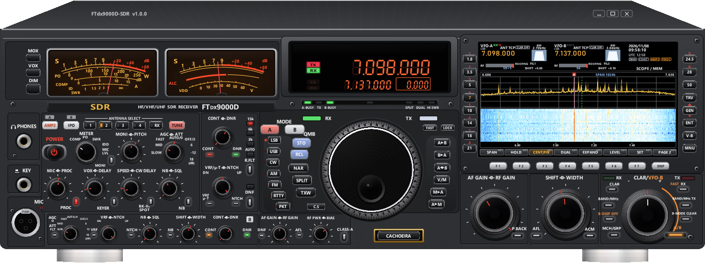

# FTdx9000D-SDR

Receptor SDR para Windows com a cara de um transceptor de HF de mesa no estilo do **FTdx9000D** (sem a marca do fabricante): os **dois S-meters analógicos** iluminados (VFO-A e VFO-B), o **VFD** com as duas frequências em 7 segmentos, a **tela TFT** com o espectro e a cachoeira, os botões do MAIN, a fileira do SUB, o dial grande e o CLAR / VFO-B. O botão **CACHOEIRA** (no lugar do cartão de memória, embaixo do dial) liga o espectro e a cachoeira grandes em cima do rádio.

## Radar Aéreo

Tela de radar em tela cheia, com a agulha girando 360°, que mostra os aviões que o dongle está ouvindo pelo **ADSB, ACARS, VDL2 e HFDL**. Mostra também as estações de terra do HFDL que transmitiram e a posição pela internet (adsb.lol) de quem foi ouvido sem posição. O alcance vai de 10 km até o planeta inteiro.

## Download

Baixe o `.zip` em **[Releases](https://github.com/Rubenpereira/FTdx9000D-SDR/releases)**, descompacte onde quiser e rode o `FTdx9000D-SDR.exe`.

**Não precisa instalar.** A configuração fica no `FTdx9000D-SDR.ini`, ao lado do programa. Roda no Windows 7 SP1, 8, 10 e 11.

As DLLs do RTL-SDR já vêm junto. Para o dongle RTL-SDR no USB, instale uma vez o driver WinUSB com o **Zadig**, que vem na pasta `Drivers` do pacote (passo a passo no `COMO_INSTALAR_DRIVER.txt`). O RTL-TCP não precisa de driver, e o SDRplay usa a [API oficial](https://www.sdrplay.com/api/) do fabricante.

## O que tem

- **Aparelhos:** RTL-SDR (USB), RTL-TCP (rede) e SDRplay (com a [API oficial](https://www.sdrplay.com/api/)), escolhidos no ANTENNA SELECT 1 / 2 / 3.
- **ADS-B pela rede:** o Radar Aéreo também mostra os aviões de outro receptor da sua rede (FlightAware/PiAware, dump1090, readsb, FR24...) pela porta Beast 30005. O FTdx9000D-SDR só lê, e o dongle fica livre.
- **Modos:** LSB, USB, CW, AM, FM estreito e FM largo.
- **Cada botão faz a função do rádio.** Os de transmissão, que num receptor não servem, ganharam funções de recepção. Pare o mouse em cima de qualquer botão: a dica diz o que ele faz.
- **Dois receptores (VFO-A e VFO-B):** cada um com o seu AF / RF, AGC, NB, DNR, NOTCH, CONT, DNF, SQL, SHIFT-WIDTH e MUTE; SPLIT, TXW, A>B, B>A, A<>B e o botão CLAR / VFO-B.
- **Filtros:** FIL1 / FIL2 / FIL3 (15k / 6k / 3k) por modo, R.FLT, NAR, SHIFT-WIDTH e BW na tela.
- **Redução de ruído e interferência:** NB e NB2, DNR (redutor espectral) e NR1, NOTCH manual, DNF (notch automático), CONT, BC, APF e PROC (compressor).
- **Frequência:** teclas de banda na tela com memória por banda, teclado numérico pelas teclas da tela (ENT), teclado do PC, roda do mouse em cada dígito do VFD, TRV e GEN (cobertura geral HF, VHF e UHF).
- **Memórias:** canais de memória (V/M, A>M, M>A, MCH/GRP) e QMB (STO / RCL).
- **Gravação:** MIC grava, P.BACK toca.
- **Outros:** MONI fala a frequência, TIMER, DIM, captura da tela (F12).
- **Decodificadores:** FT8 e FT4 (lista igual à do WSJT-X, com SNR, DT e frequência), CW, RTTY, SITOR-B/NAVTEX, DSC, ALE, PACTOR, PSK (BPSK31/63/125/250, QPSK31/63/125, BPSK63F e BPSK125F), DMR/P25/NXDN/dPMR/YSF/D-STAR, TETRA, HFDL, AIS, APRS, ACARS, VDL2, SELCAL (chamada seletiva dos aviões), DRM, SSTV, WEFAX, satélites e analisador de sinal.

O guia completo dos botões (parte por parte do painel) está no [LEIA-ME.txt](LEIA-ME.txt).

## Compilar

Precisa do Visual Studio 2022 (ou Build Tools) com C++ e do CMake. Rode `COMPILAR.bat`: o programa sai em `pronto\FTdx9000D-SDR.exe`.

Os decodificadores externos (dsd-fme, AIS-catcher, direwolf etc.) não estão neste repositório. Eles vêm no `.zip` da release; veja o [TERCEIROS.txt](TERCEIROS.txt).

## Licença

Software livre, **GNU GPL versão 3**. Veja o [LICENSE.txt](LICENSE.txt). Os programas de terceiros seguem as licenças deles ([TERCEIROS.txt](TERCEIROS.txt)).

## Privacidade / Privacy

This program will not transfer any information to other networked systems unless specifically requested by the user or the person installing or operating it. It connects to the RTL-TCP server the user configures (and, if the user turns it on, to the ADS-B receiver on the local network that the user types in Configuration), and opens web links (for example aprs.fi or FlightAware) only when the user clicks them.

Online lookups are **off by default**. They run only after the user turns them on, and the choice is saved in `FTdx9000D-SDR.ini`:

- **"Look up registration and model on the web (hexdb.io)"** in the ADSB decoder sends the ICAO address or the registration of the aircraft heard to hexdb.io.
- **"Position from the internet (adsb.lol)"** on the Aerial Radar screen sends the ICAO address, registration or flight of the aircraft heard to adsb.lol, and also a position when completing an HFDL flight number. If the user enters their own ADS-B Exchange API key, the same lookups also go to ADS-B Exchange (RapidAPI).

The satellite tracker downloads public orbital elements (TLE) from Celestrak when the user opens it and the local file is missing or more than a day old, or when the user clicks "Update TLE". Nothing about the user is sent.

*Este programa não envia nenhuma informação para outros computadores, a não ser quando o próprio usuário pede. Ele se conecta ao servidor RTL-TCP que o usuário configurar (e, se o usuário ligar, ao receptor de ADS-B da rede local que ele digitar na Configuração) e só abre links da internet quando o usuário clica neles.*

*As consultas pela internet vêm **desligadas**. Só funcionam depois que o usuário liga, e a escolha fica guardada no `FTdx9000D-SDR.ini`:*

- *"Buscar prefixo e modelo na internet (hexdb.io)", no decodificador ADSB, manda ao hexdb.io o código ICAO ou o prefixo dos aviões ouvidos.*
- *"Posição pela internet (adsb.lol)", na tela do Radar Aéreo, manda ao adsb.lol o código ICAO, o prefixo ou o voo dos aviões ouvidos, e uma posição quando completa o voo do HFDL. Com a chave do ADS-B Exchange do próprio usuário, as mesmas consultas vão também para o ADS-B Exchange (RapidAPI).*

*O rastreador de satélites baixa da Celestrak os elementos orbitais públicos (TLE) quando o usuário abre essa tela e o arquivo não existe ou tem mais de um dia, ou quando o usuário clica em "Atualizar TLE". Nada sobre o usuário é enviado.*

## Desinstalar / Uninstall

FTdx9000D-SDR is portable: it is not installed and changes nothing in Windows. To remove it, delete its folder.

*O FTdx9000D-SDR é portátil: não instala nada no Windows. Para remover, basta apagar a pasta dele.*
